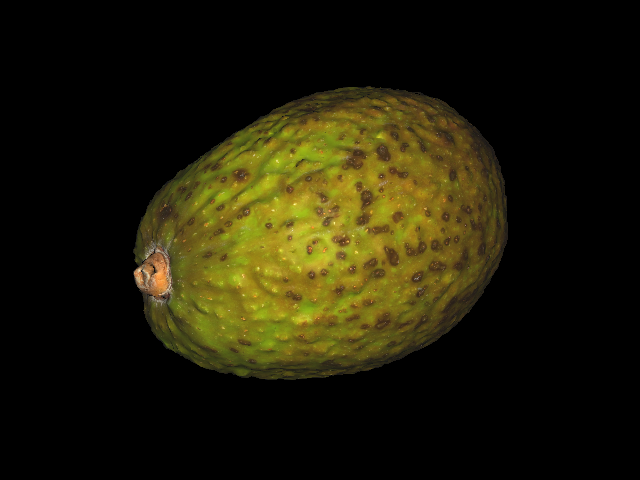

# obj-viewer



An OBJ file viewer that uses software rasterization. This was my first time 
making an actual project in C, and I tried to make the code good. This includes
error checking (SO MUCH ERROR CHECKING), thread safety, and decent memory 
management. There is NO security guarantee for this project.

## Support
Despite all of the following constraints, many OBJ files will be fully 
supported by this program; these are the most common attributes in OBJ and MTL 
files.

### Faces
Convex faces up to four vertices are supported.

### Materials
The following material properties are supported:
- `Ka`
- `Kd`
- `Ks`
- `Ns`
- `map_Ka`
- `map_Kd`
- `map_Ks`
- `map_Ns`

### Filenames
Spaces in file and material names are not supported. Names spaces in their name
will be equivalent to materials without them (e.g. "1 2 3" == "123").

## Features
- Screenshots
- Backface culling
- Near clipping
- Flat and smooth shading with Phong illumination
- Texture mapping and material support

## Building from Source
To build this project from source, install `SDL3`, `SDL3_image`, and 
`SDL3_ttf`, and run these commands in your favorite terminal emulator:

```bash
git clone https://github.com/tomatofoo/obj-viewer
cd obj-viewer
cmake -B build -DCMAKE_BUILD_TYPE=Release -DDEV=ON
cmake --build build
```

The output file is `build/main.out`. Move this to the root directory of the 
repository for it to run properly:
```bash
mv build/main.out .
```

## Usage
Drag an OBJ file to the app window. The program will open the file.

### Keys
- `W`: Move forward
- `A`: Strafe left
- `S`: Move backward
- `D`: Strafe right
- `Space`: Move up
- `Left Shift`: Move down
- `Left`: Look left
- `Right`: Look right
- `Up`: Look up
- `Down`: Look down 
- `[`: Increase quality
- `]`: Increase quality
- `B`: Toggle backface culling
- `C`: Toggle near clipping
- `F2`: Take a screenshot (supports PNG and JPEG, default PNG)

